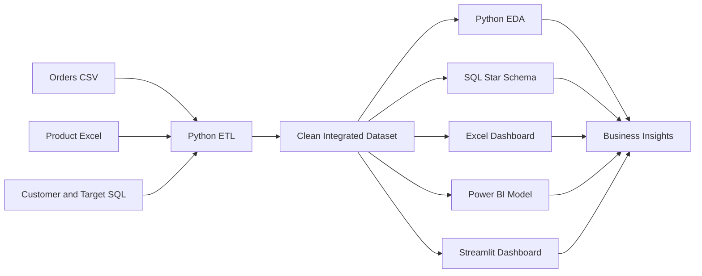

# Retail Sales & Customer Insights Analytics Dashboard

A complete, portfolio-ready Data Analytics major project that integrates **CSV, Excel and SQL data**, performs data cleaning and exploratory analysis, calculates business KPIs, segments customers, and prepares dashboards for **Excel, Power BI and Streamlit**.


## Project Highlights

- Integrated **orders from CSV**, **products from Excel**, and **customer/target data from SQLite**.
- Cleaned duplicates, missing values, invalid dates, incorrect data types and quantity outliers.
- Performed descriptive statistics, EDA, correlation, trend, regional, product, channel and discount analysis.
- Built **RFM customer segmentation** for Champions, Loyal Customers, At Risk, Hibernating and Potential Loyalists.
- Created a formula-driven **Excel dashboard** with KPI cards and charts.
- Included a Power BI star schema, Power Query M code, DAX measures, theme and dashboard build guide.
- Built a filterable **Streamlit dashboard** with downloadable data.
- Added reusable SQL queries using joins, CTEs, window functions, ranking, moving averages, CASE statements and Pareto analysis.
- Added automated tests and a data-quality report.

## Technology Stack

| Area | Tools and Technologies |
|---|---|
| Programming | Python |
| Data Manipulation | Pandas, NumPy |
| Database | SQL, SQLite |
| Spreadsheet Analytics | Microsoft Excel |
| Business Intelligence | Power BI, Power Query, DAX |
| Visualization | Matplotlib, Seaborn, Excel charts, Streamlit |
| Development | Jupyter Notebook, VS Code, Git, GitHub |
| Testing | Pytest |

## Dataset and KPI Results

The synthetic business dataset covers **January 2024 to July 2026**.

| KPI | Result |
|---|---:|
| Clean Transactions | 4,180 |
| Total Revenue | ₹160,102,619 |
| Total Profit | ₹41,281,840 |
| Profit Margin | 25.8% |
| Total Orders | 3,922 |
| Unique Customers | 320 |
| Average Order Value | ₹40,822 |
| Return Rate | 8.8% |

## Data Sources

1. `data/raw/orders.csv` — raw order transactions with intentional quality issues.
2. `data/raw/product_master.xlsx` — product, category, cost and price information.
3. `data/raw/retail_source.db` — customer master and monthly regional targets.

The Python pipeline integrates these files into `data/processed/retail_sales_clean.csv`.

## Project Workflow



## Folder Structure

```text
Retail_Sales_Customer_Insights_Analytics/
├── app.py
├── run_pipeline.py
├── run_project.bat
├── requirements.txt
├── data/
│   ├── raw/
│   │   ├── orders.csv
│   │   ├── product_master.xlsx
│   │   └── retail_source.db
│   ├── processed/
│   │   ├── retail_sales_clean.csv
│   │   ├── retail_analytics.db
│   │   ├── kpi_summary.csv
│   │   ├── monthly_trend.csv
│   │   ├── region_summary.csv
│   │   ├── category_summary.csv
│   │   ├── product_summary.csv
│   │   └── customer_rfm.csv
│   └── reference/
├── excel/
│   └── Retail_Sales_Analytics_Dashboard.xlsx
├── notebooks/
│   └── Retail_Sales_Analytics.ipynb
├── powerbi/
│   ├── FactSales.csv
│   ├── DimCustomer.csv
│   ├── DimProduct.csv
│   ├── DimDate.csv
│   ├── SalesTargets.csv
│   ├── DAX_Measures.txt
│   ├── Power_Query_M_Code.txt
│   ├── model_relationships.md
│   ├── Power_BI_Dashboard_Guide.md
│   └── retail_analytics_theme.json
├── reports/
│   ├── business_insights.md
│   └── figures/
├── sql/
│   ├── 01_schema.sql
│   ├── 02_analytics_queries.sql
│   └── 03_data_quality_checks.sql
├── src/
│   ├── data_pipeline.py
│   ├── create_database.py
│   └── analysis.py
└── tests/
    └── test_pipeline.py
```

## How to Run

### Windows

Double-click:

```text
run_project.bat
```

Or run manually:

```bash
python -m pip install -r requirements.txt
python run_pipeline.py
streamlit run app.py
```

### Jupyter Notebook

```bash
jupyter notebook notebooks/Retail_Sales_Analytics.ipynb
```

### Tests

```bash
pytest -q
```

Expected result:

```text
4 passed
```

## Excel Dashboard

Open:

```text
excel/Retail_Sales_Analytics_Dashboard.xlsx
```

Sheets include:

- Dashboard
- Sales Data
- Monthly Trend
- Region Analysis
- Category Analysis
- Customer RFM
- Data Quality
- Data Dictionary

## Power BI Instructions

1. Open Power BI Desktop.
2. Import the CSV files from the `powerbi` folder.
3. Create relationships using `powerbi/model_relationships.md`.
4. Paste the measures from `powerbi/DAX_Measures.txt`.
5. Use `powerbi/Power_BI_Dashboard_Guide.md` to build the four report pages.
6. Import `powerbi/retail_analytics_theme.json` as the report theme.
7. Use the included Power Query M code when loading the flat processed dataset.

A `.pbix` file is not included because it must be created with Microsoft Power BI Desktop; all data-model files, M code, DAX measures and dashboard specifications are included.

## SQL Concepts Demonstrated

- DDL and star-schema design
- Primary and foreign keys
- Indexes and views
- INNER and LEFT JOIN
- Aggregate functions and `GROUP BY`
- `CASE WHEN`
- Subqueries
- Common table expressions
- `LAG`, `DENSE_RANK`, `ROW_NUMBER`
- Moving averages
- Year-over-year growth
- Pareto contribution analysis
- Data-quality checks

## Major Business Questions Answered

- What are total revenue, profit, margin, orders and average order value?
- Which month, region, category, product and channel perform best?
- Are monthly revenue and profit targets being achieved?
- How do discounts affect profit?
- Which customers are Champions, Loyal, At Risk or Hibernating?
- Which products generate high revenue but weak margins?
- Where are returns highest?
- Which customers show declining recent spend?

## Resume Description

**Retail Sales & Customer Insights Analytics Dashboard**  
**Tools:** Python, SQL, Excel, Power BI, Pandas, NumPy, Power Query, DAX, Matplotlib, Seaborn

- Integrated CSV, Excel and SQL sales data; cleaned missing values, duplicates, data types and outliers, then performed EDA, correlation, segmentation and trend analysis.
- Built an interactive analytics solution with revenue, profit, growth, order, customer, product, regional and target KPIs; translated insights into business recommendations.

## GitHub Upload Commands

```bash
git init
git add .
git commit -m "Add retail sales customer insights analytics project"
git branch -M main
git remote add origin https://github.com/YOUR_USERNAME/Retail-Sales-Customer-Insights-Analytics.git
git push -u origin main
```
