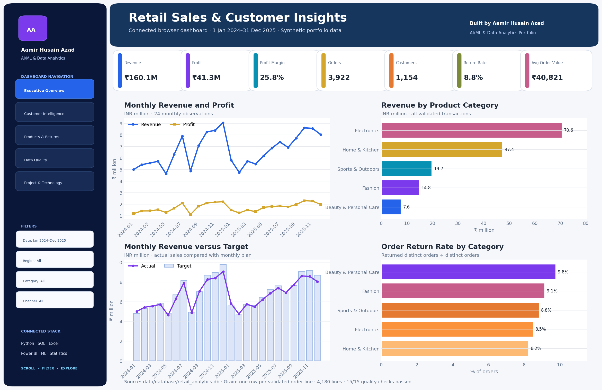
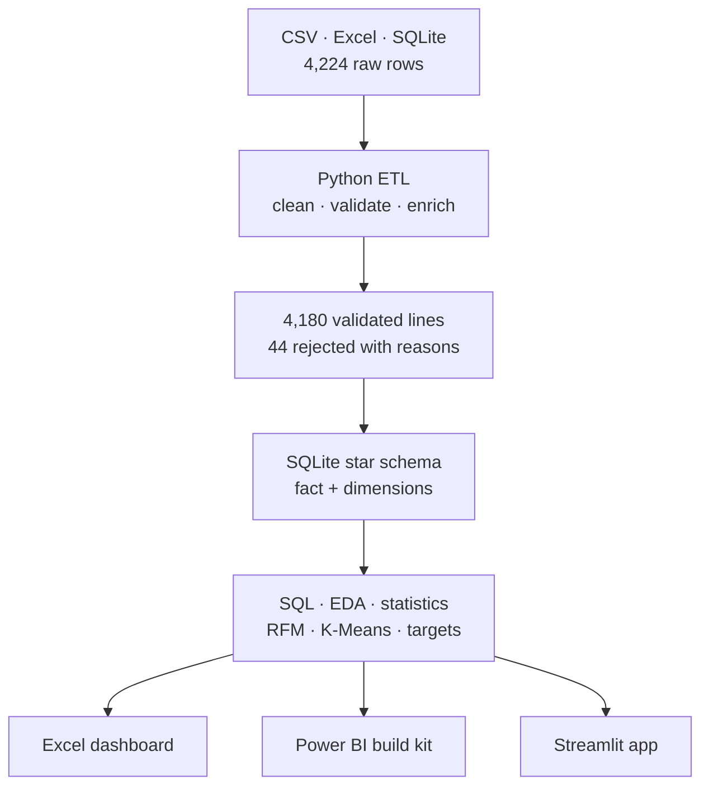

# Retail Sales & Customer Insights Analytics Dashboard

**Major Data Analytics Project · Python · SQL · SQLite · Excel · Power BI · Streamlit**

[](https://www.python.org/)
[](https://www.sqlite.org/)
[](#dashboard-deliverables)
[](data/quality/data_quality_checks.csv)

## Project Summary

This portfolio project demonstrates an end-to-end retail analytics workflow. It integrates **4,224 synthetic records** from CSV, Excel and SQLite sources; applies auditable cleaning and rejection rules; retains **4,180 validated order lines**; builds a SQL star schema; performs EDA, RFM and K-Means customer segmentation, statistics, discount, return and target analysis; and delivers Excel, Power BI-ready and Streamlit dashboards.

> All customer and transaction data is synthetic. No real personal or company data is included.

## Headline KPIs

| KPI | Validated result | Definition |
|---|---:|---|
| Revenue | **₹160.1M** | Sales after discounts less return amounts |
| Profit | **₹41.3M** | Revenue less recognized cost |
| Profit Margin | **25.8%** | Profit ÷ Revenue |
| Orders | **3,922** | Distinct `order_id` count |
| Returned Orders | **345** | Distinct returned orders |
| Return Rate | **8.8%** | Returned Orders ÷ Orders |
| Validated Lines | **4,180** | One row per accepted order line |

## Dashboard Preview



## Business Questions Answered

- How are revenue, profit, margin and orders changing month by month?
- Which categories, products, regions and channels contribute the most value?
- Which customer groups are Champions, Loyal, At Risk or Hibernating?
- Which behavioral customer clusters emerge from recency, frequency and revenue?
- How do discount bands affect profitability?
- Which categories and channels have the highest return rates?
- Which months met or missed the revenue target?
- Can every headline metric be reconciled across Python, SQL and Excel?

## Technical Architecture



## Data Quality Design

The raw sources contain 44 isolated defects so the pipeline demonstrates realistic quality handling without inventing findings after the fact.

| Rejection reason | Rows |
|---|---:|
| Duplicate `line_id` | 10 |
| Missing `customer_id` | 8 |
| Invalid order/ship date | 8 |
| Non-positive quantity | 6 |
| Discount outside allowed range | 6 |
| Invalid product key | 6 |
| **Total rejected** | **44** |

The pipeline also imputes 31 optional missing ratings with the observed median and retains an `rating_was_imputed` audit flag. The automated quality suite checks volume, uniqueness, completeness, type/range validity, referential integrity, revenue arithmetic, profit arithmetic, order reconciliation and rejected-row reconciliation.

## Star Schema

The SQLite analytics model uses one line-grain fact table and conformed dimensions.

- `fact_sales`: 4,180 order lines and additive measures.
- `dim_date`: calendar and time-intelligence attributes.
- `dim_customer`: customer attributes plus RFM scores and segment.
- `dim_product`: category and subcategory hierarchy.
- `dim_store`: store and channel attributes.
- `monthly_targets`: one target row per year-month.
- `customer_rfm`: reusable customer-level RFM output.

See [Power BI star schema](power_bi/model/star_schema.md) and [SQL DDL](sql/01_create_star_schema.sql).

## Analysis Highlights

- **Electronics** generated ₹70.6M revenue, the largest category contribution, with a 21.0% margin.
- **Beauty & Personal Care** delivered the highest category margin at 40.4%, but also the highest return rate at 9.8%.
- **Online** was the largest channel at ₹76.8M revenue; Retail Store had the lowest channel return rate at 7.8%.
- **West** was the largest region at ₹37.9M revenue.
- **Champions** represented 176 customers and ₹45.7M revenue; 194 At-Risk customers represented ₹29.5M.
- Profit margin declined from 34.5% with no discount to 10.1% above 20% discount, indicating the need for controlled promotional depth.

These are descriptive findings from synthetic data, not causal claims.

## Dashboard Deliverables

### Excel

`excel/Retail_Sales_Customer_Insights_Dashboard.xlsx`

- Formula-driven KPI cards and monthly/category/channel tables.
- Six native charts with summary-first layout.
- Transactions, Monthly KPIs, Category Analysis, Customer RFM, Data Quality and Data Dictionary sheets.
- Frozen headers, tables, comments, number formats and quality status.

### Power BI

`power_bi/`

- Power Query M ingestion and type transformations.
- DAX measures for KPI, targets, time intelligence, customer and return analysis.
- Star-schema relationship specification, validation queries and branded theme.
- Five-page visual build plan.

The compiled PBIX must be saved in Power BI Desktop; the source kit is fully provided and auditable.

### Streamlit

`streamlit_app/app.py`

- Colorful responsive full-browser design with a professional sidebar and author panel for Aamir Husain Azad.
- Global date, region, category, channel and customer-segment filters with one-click reset.
- Executive Overview, Customer Intelligence, Products & Returns, Data Quality and Project & Technology pages.
- Sticky in-page section navigation, page scroll progress, responsive layouts and a floating back-to-top control.
- Customer recency-frequency scatter, RFM lifecycle analysis and deterministic K-Means ML customer clusters.
- Statistics Lab with distribution, correlation, confidence-interval and discount-band analysis.
- Technology showcase for Python, SQL/SQLite, Excel, Power BI, Power Query, DAX, ML, statistics and testing.
- Connected download hub for filtered CSV, Excel, SQLite, Power BI DAX, Power Query and quality documentation.
- SQLite-backed deterministic reads and clear empty/error states.

## Repository Structure

```text
Retail_Sales_Customer_Insights_Analytics/
├── data/
│   ├── raw/                 # CSV, Excel and SQLite source files
│   ├── processed/           # Fact, dimensions, RFM and dashboard payload
│   ├── database/            # Final SQLite analytics database
│   └── quality/             # Quality checks, rejected rows and manifests
├── src/                     # Generator, ETL, quality, schema, analytics, charts
├── sql/                     # DDL, KPIs, RFM, product, return and QA queries
├── excel/                   # Formula-driven Excel dashboard
├── power_bi/                # M, DAX, theme, model and page plan
├── streamlit_app/           # Interactive application
├── notebooks/               # Executed analysis notebook
├── reports/                 # Findings, dictionary and PNG charts
├── tests/                   # Automated KPI, quality and schema tests
├── docs/                    # Architecture, guide, interview and GitHub notes
└── scripts/                 # Build, execute and verify utilities
```

## Quick Start

```bash
python -m venv .venv
source .venv/bin/activate          # Windows: .venv\Scripts\activate
pip install -r requirements.txt
python -m src.run_pipeline
python -m unittest discover -s tests -v
streamlit run streamlit_app/app.py
```

The raw source files are already included. `python -m src.generate_data` deterministically regenerates the synthetic raw split with seed `20260804`; the Excel source file is delivered as part of the repository.

## Reconciliation Commands

```bash
sqlite3 data/database/retail_analytics.db < sql/02_kpi_queries.sql
python scripts/verify_project.py
```

Expected all-data results: ₹160,100,000 revenue; ₹41,300,000 profit; 3,922 orders; 345 returned orders; 4,180 fact rows; zero broken dimension joins.

## Author

**Aamir Husain Azad** · AI/ML and Data Analytics portfolio project
