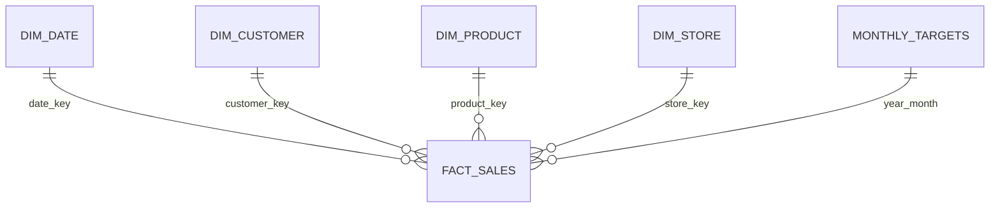

# Power BI Star Schema

## Table grains

| Table | Grain | Key |
|---|---|---|
| Fact Sales | One validated order line | `sale_key`; business key `line_id` |
| Dim Date | One calendar date | `date_key` |
| Dim Customer | One customer | `customer_key` |
| Dim Product | One product | `product_key` |
| Dim Store | One store/channel location | `store_key` |
| Monthly Targets | One calendar month | `year_month` |

## Relationships

| From | To | Cardinality | Cross-filter |
|---|---|---|---|
| `Dim Date[date_key]` | `Fact Sales[date_key]` | 1:* | Single |
| `Dim Customer[customer_key]` | `Fact Sales[customer_key]` | 1:* | Single |
| `Dim Product[product_key]` | `Fact Sales[product_key]` | 1:* | Single |
| `Dim Store[store_key]` | `Fact Sales[store_key]` | 1:* | Single |
| `Monthly Targets[year_month]` | `Fact Sales[year_month]` | 1:* | Single |

Use dimension-to-fact filtering only. Do not create direct relationships between dimension tables. Mark `Dim Date[date]` as the date table and sort `month_name` by `month_no` and `year_month` by `year_month_sort`.

